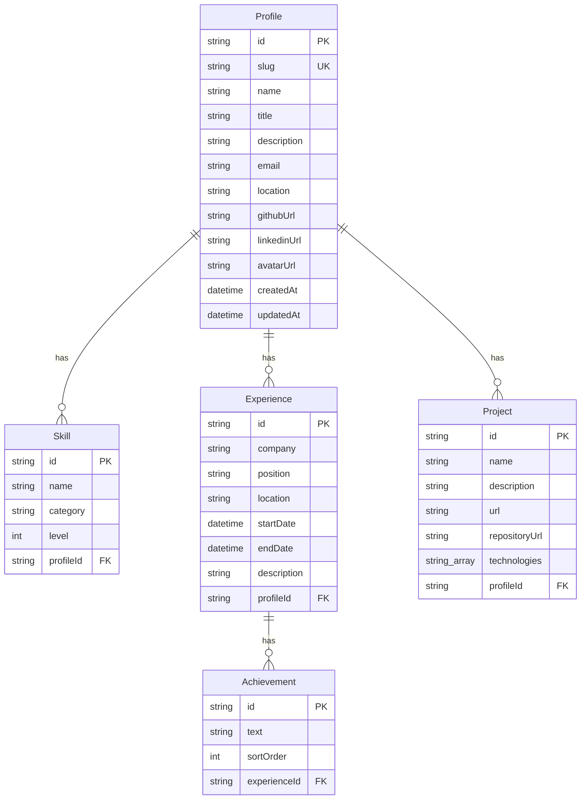

# Digital Business Card — backend

Backend-приложение «цифровая визитка» на NestJS, Prisma, PostgreSQL и GraphQL. Отдаёт профиль, навыки, опыт работы с достижениями и проекты; в браузере доступен Apollo Sandbox. Запускается с нуля одной командой, сам применяет миграции и заполняет базу.

> Публичные ссылки на живое приложение и репозиторий добавляются на финальном шаге деплоя.

## Стек

| Компонент | Версия | Зачем |
| --- | --- | --- |
| Node.js | 22 LTS | runtime в Docker; локально >= 20.19 |
| TypeScript | 6.0 | strict-режим |
| NestJS | 12.3 | модульная архитектура, DI |
| GraphQL | 16.14 | code-first, Apollo Sandbox |
| Apollo Server | 5.5 | GraphQL-сервер; требует GraphQL 16 |
| Prisma | 7.10 | ORM, миграции, типобезопасный клиент |
| PostgreSQL | 16 | основная БД |
| DataLoader | 2.2 | батчинг вложенных выборок |
| Vitest | 5.1 | unit и e2e |
| Testcontainers | 12.2 | реальный PostgreSQL в e2e |
| Docker / Compose | — | запуск с нуля и деплой |

## Быстрый старт

```bash
docker compose up --build
```

После старта:

- Apollo Sandbox: <http://localhost:3000/graphql>
- Healthcheck: <http://localhost:3000/health>

Если порт 3000 занят:

```bash
APP_PORT=3010 docker compose up --build
# Sandbox: http://localhost:3010/graphql
```

Compose поднимает PostgreSQL 16, ждёт его готовности, применяет миграции в entrypoint контейнера и запускает приложение. Приложение при bootstrap идемпотентно заполняет БД данными из `src/database/seed-data.ts`. Повторный запуск не создаёт дублей.

Полная проверка Docker-сценария:

```bash
APP_PORT=3010 npm run smoke:docker
```

Скрипт собирает образ, поднимает compose, ждёт `/health`, выполняет вложенный GraphQL-запрос и гасит окружение.

## Локальная разработка

Нужен PostgreSQL 16. Например:

```bash
docker run --rm -d --name business-card-db \
  -e POSTGRES_PASSWORD=postgres \
  -e POSTGRES_DB=business_card \
  -p 5432:5432 \
  postgres:16-alpine
```

Затем:

```bash
cp .env.example .env
npm ci
npm run prisma:generate
npm run prisma:deploy
npm run start:dev
```

`npm run start:dev` поднимет приложение на `http://localhost:3000/graphql`; при bootstrap выполнятся идемпотентные сиды. Для отдельного запуска сидов есть `npm run seed`.

Если локальный порт 5432 занят, используйте другой порт в `docker run` и соответствующий `DATABASE_URL` в `.env`.

## GraphQL API

### Запрос из тестового задания

```graphql
query {
  profile {
    name
    description
    skills {
      name
    }
    experience {
      company
      position
    }
    projects {
      name
    }
  }
}
```

### Расширенный запрос

```graphql
query {
  profile {
    id
    name
    title
    description
    email
    location
    githubUrl
    linkedinUrl
    skills {
      name
      category
      level
    }
    experience {
      company
      position
      startDate
      endDate
      achievements {
        text
      }
    }
    projects {
      name
      description
      url
      repositoryUrl
      technologies
    }
  }
}
```

Схема — code-first (`src/**/*.types.ts`), сгенерированная версия лежит в [`src/schema.gql`](src/schema.gql).

## Архитектура

### Слои и поток запроса

```text
Apollo Sandbox / HTTP client
            │
            ▼
GraphQL resolver (transport)
            │
            ▼
Service (бизнес-логика)
            │
            ├── DataLoader (батчинг вложенных связей)
            │
            ▼
PrismaService (доступ к данным)
            │
            ▼
PostgreSQL
```

- Резолверы только принимают аргументы и делегируют в сервисы или loader-ы.
- Сервисы содержат бизнес-логику и запросы к Prisma; о GraphQL-типах не знают.
- PrismaService инкапсулирует подключение и lifecycle.
- Feature-модули: `profile`, `skill`, `experience`, `project`; инфраструктура — `prisma`, `config`, `database`, `common`, `health`.

### Почему code-first

Типы описываются декораторами рядом с TypeScript-классами. Нет дублирования схемы и DTO, работает автодополнение, а `src/schema.gql` всегда соответствует коду. Для небольшого API это дешевле и надёжнее schema-first.

### DataLoader и отсутствие N+1

Вложенные поля резолвятся через request-scoped `ProfileLoaders`:

- `Profile.skills`, `Profile.projects`, `Profile.experience` — батчинг по `profileId`;
- `Experience.achievements` — батчинг по `experienceId`.

Один GraphQL-запрос создаёт новый экземпляр loader-ов, поэтому кеш не переносится между запросами. Внутри запроса DataLoader собирает ключи и выполняет один `findMany` с `IN (...)` вместо запроса на каждый родительский объект.

Отсутствие N+1 доказывается e2e-тестом:

1. В сидах два опыта работы с достижениями.
2. Тест подписывается на события `query` Prisma и очищает счётчик.
3. Выполняется запрос `profile { experience { achievements { text } } }`.
4. Тест проверяет, что SQL-запросов к `Achievement` ровно один, а достижения вернулись для всех опытов.

Юнит-тесты отдельно проверяют батчинг, группировку, дедупликацию ключей, пустые коллекции и изоляцию loader-ов между экземплярами.

### Prisma 7 и CommonJS

NestJS-проект собран в CommonJS, поэтому генератор Prisma настроен с `moduleFormat = "cjs"`. Клиент генерируется в `src/generated/prisma` (каталог не коммитится) и компилируется вместе с приложением. Prisma 7 требует driver adapter; используется `@prisma/adapter-pg` поверх `pg`.

## База данных

### Схема



Индексы по `profileId` и `experienceId`, каскадное удаление дочерних записей. `Achievement.sortOrder` задаёт стабильный порядок достижений.

### Миграции

- Локально: `npm run prisma:migrate -- --name <name>`.
- В Docker, CI и на проде: `prisma migrate deploy` в entrypoint перед стартом приложения.
- SQL миграций коммитится в `prisma/migrations`.

### Сиды

- Логика — `src/database/seed-database.ts`.
- Данные — `src/database/seed-data.ts` (временные плейсхолдеры, заменить перед сдачей).
- `SeedService` вызывается в `onApplicationBootstrap`.
- Идемпотентность: поиск профиля по уникальному `slug`; если профиль есть — no-op, иначе создание профиля со связями одной вложенной операцией.
- Ручной запуск: `npm run seed` (Prisma `db seed` → `tsx prisma/seed.ts`).

## Тесты и качество

```bash
npm run typecheck   # tsc --noEmit
npm run test:unit   # Vitest, src/**/*.spec.ts
npm run test:e2e    # Vitest + Testcontainers + реальный PostgreSQL + supertest
npm run validate    # typecheck + unit + e2e
npm run lint
npm run build
```

E2E-контур:

- `tests/e2e/global-setup.ts` поднимает PostgreSQL через Testcontainers и применяет `prisma migrate deploy`.
- `tests/e2e/setup.ts` прокидывает `DATABASE_URL` и включает событийное логирование запросов.
- Приложение создаётся реальным Nest-модулем, запросы идут по HTTP через supertest.
- Проверяются health, схема БД, сиды, вложенные GraphQL-поля, introspection, Sandbox, безопасные ошибки, CORS и отсутствие N+1.

Браузерная автоматизация (Playwright) не используется: продукт — backend API, проверять UI нечего. E2E-драйвер — HTTP и реальная БД; это осознанное решение, а не пропуск тестов.

## Docker

- Multi-stage `Dockerfile`: зависимости → сборка (`prisma generate` + `nest build`) → runtime.
- Runtime на `node:22-slim`, non-root пользователь `node`, `npm ci --omit=dev`.
- `prisma` CLI и `dotenv` оставлены в production dependencies: entrypoint выполняет `prisma migrate deploy` до старта приложения. Это увеличивает образ, но убирает отдельный migrate-контейнер и гарантирует готовность БД.
- `docker-compose.yml`: PostgreSQL с healthcheck, volume и приложение с `depends_on: service_healthy`.
- Порт приложения настраивается через `APP_PORT` (по умолчанию 3000).

## Деплой на Railway

1. Создать проект и добавить PostgreSQL.
2. Подключить GitHub-репозиторий; Railway соберёт `Dockerfile`.
3. Задать переменные:
   - `DATABASE_URL` — ссылка на PostgreSQL;
   - `NODE_ENV=production`;
   - `CORS_ORIGIN=*` (для демо).
4. Healthcheck — `/health`.
5. После деплоя открыть `/graphql` и выполнить запрос из тестового задания.

Entrypoint применит миграции, приложение выполнит идемпотентные сиды. Публичный URL добавляется в этот README после деплоя.

## Переменные окружения

| Переменная | Обязательна | По умолчанию | Назначение |
| --- | --- | --- | --- |
| `DATABASE_URL` | да | — | строка подключения PostgreSQL |
| `PORT` | нет | `3000` | порт HTTP-сервера |
| `NODE_ENV` | нет | `development` | режим приложения |
| `CORS_ORIGIN` | нет | `*` | разрешённые origin через запятую |
| `PRISMA_LOG_QUERIES` | нет | `false` | событийное логирование SQL для e2e-счётчика |

## Структура проекта

```text
.
├── prisma/
│   ├── schema.prisma
│   ├── migrations/
│   └── seed.ts
├── src/
│   ├── main.ts
│   ├── app.module.ts
│   ├── app.setup.ts
│   ├── config/            # валидация env
│   ├── prisma/            # PrismaModule, PrismaService
│   ├── database/          # seed-data, seed-database, SeedService
│   ├── graphql/           # GraphQLModule, Sandbox
│   ├── common/
│   │   ├── dataloaders/   # one-to-many loader
│   │   └── graphql/       # formatError
│   ├── health/
│   ├── profile/           # Profile, loaders, ExperienceResolver
│   ├── skill/
│   ├── experience/        # Experience, Achievement + сервисы
│   └── project/
├── tests/e2e/
├── Dockerfile
├── docker-compose.yml
├── docker/entrypoint.sh
├── scripts/smoke-docker.sh
├── prisma7.config.ts
└── src/schema.gql
```

## Архитектурные решения и компромиссы

- **Feature-модули вместо слоёв-папок целиком.** Каждая предметная область содержит свой тип, сервис и, где нужно, loader/resolver. Это упрощает навигацию и не смешивает GraphQL с доступом к данным.
- **DataLoader на каждую связь, request-scoped.** Гарантирует отсутствие N+1 и отсутствие утечки кеша между запросами. Цена — создание нескольких небольших объектов на запрос, что для визитки незаметно.
- **Code-first GraphQL.** Меньше дублирования и выше типобезопасность; схема генерируется в `src/schema.gql` и коммитится для наглядности.
- **Prisma 7 + CJS.** Современный Prisma с Rust-free клиентом и adapter-pg; CJS выбран для совместимости с текущим NestJS-тулчейном. GraphQL 16, а не 17, потому что Apollo Server 5 требует `^16.11`.
- **Миграции в entrypoint, сиды в bootstrap.** Миграции — инфраструктурная операция перед стартом; сиды — обычный код приложения, который можно тестировать и запускать отдельно. Обе операции идемпотентны.
- **`prisma` CLI в production dependencies.** Компромисс в пользу простого одношагового запуска: миграции применяются тем же контейнером, без отдельного job.
- **Introspection включён.** Это требование демо/тестового задания. В реальном проде его стоит отключить и ограничить доступ к Sandbox.
- **Нет auth, mutations и S3.** Вне scope тестового задания: нужен публичный read-only API. Поле `avatarUrl` — строка, без загрузки файлов.
- **Временные данные.** `src/database/seed-data.ts` содержит плейсхолдеры; перед сдачей заменить на реальные данные и проверить ссылки.

## Чек-лист требований

- [x] Git-репозиторий с осмысленной историей.
- [x] TypeScript, Node.js, NestJS.
- [x] PostgreSQL и Prisma с миграциями.
- [x] GraphQL API и Apollo Sandbox.
- [x] Профиль: имя, описание, ссылки.
- [x] Навыки.
- [x] Опыт: компания, должность, период, достижения.
- [x] Проекты: название, ссылки.
- [x] Автоматическая подготовка и заполнение БД при запуске.
- [x] DataLoader и доказуемое отсутствие N+1.
- [x] Docker: запуск с нуля.
- [x] README с обоснованием решений.
- [ ] Публичная ссылка на приложение (Railway).
- [ ] Ссылка на Git-репозиторий.
- [ ] Реальные данные кандидата вместо плейсхолдеров.
